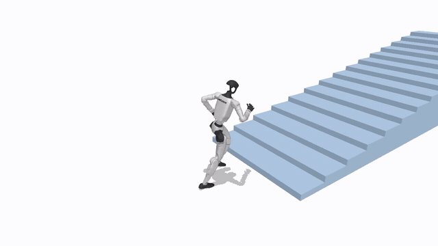
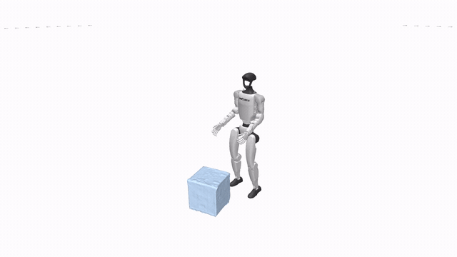
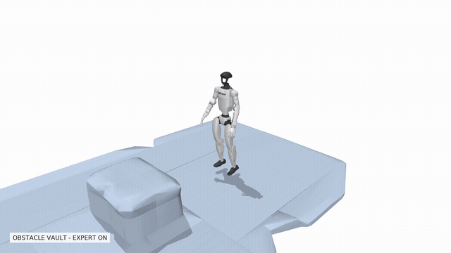
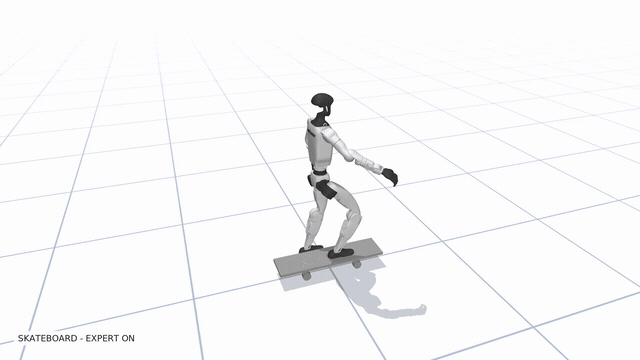
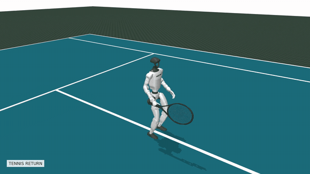
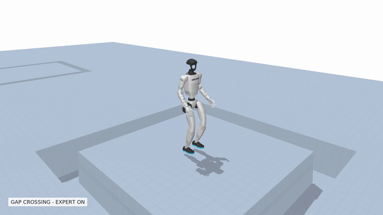

<div align="center">

# PERA

**Plug-in Experts for Robotic Actions in Continual Whole-Body Control**

[English](README.md) · [简体中文](README.zh-CN.md) · [Website source](https://github.com/shangchaohu718/PERA/tree/main/website) · [Models](docs/MODELS.md) · [Setup](docs/ENVIRONMENT.md)

</div>

The open-source release of PERA is based on the official HoloMotion G1 v1.4 `model_14000` weights and provides task experts, inference code, and scene reproduction resources.

## Skill gallery

<table>
<tr>
<td align="center" width="33%"><b>Stair ascent</b><br/><a href="docs/media/stairs.mp4"></a></td>
<td align="center" width="33%"><b>Box carrying</b><br/><a href="docs/media/box-carrying.mp4"></a></td>
<td align="center" width="33%"><b>Obstacle vault</b><br/><a href="docs/media/vault.mp4"></a></td>
</tr>
<tr>
<td align="center" width="33%"><b>Skateboarding</b><br/><a href="docs/media/skateboard.mp4"></a></td>
<td align="center" width="33%"><b>Tennis returns</b><br/><a href="docs/media/tennis.mp4"></a></td>
<td align="center" width="33%"><b>Gap crossing</b><br/><a href="docs/media/gap-crossing.mp4"></a></td>
</tr>
</table>

<sub>Individual student recordings from the project homepage, at original speed. GIFs loop for preview; click a scene to open its video. These are recorded rollouts, not a new success-rate evaluation.</sub>

## Installation

Use Python 3.11 and the pinned [scene replay environment](docs/SCENE_REPRODUCTION.md).

```bash
python -m pip install -r requirements/scene-replay.txt -c requirements/scene-replay.lock.txt
```

## Models

One expert-bank file contains 25 matching task experts. The reproducible scene suite covers 15 tasks in three sequential groups. See the [skill inventory and single-checkpoint guide](docs/HOLOMOTION_SKILLS.zh-CN.md). Official HoloMotion Actor/Critic weights are not redistributed. Download the exact v1.4.0 base from the official repository using [the download guide](docs/HOLOMOTION_DOWNLOAD.md), then verify the files against [the HoloMotion weight manifest](resources/holomotion_weights_manifest.json).

```bash
python tools/check_holomotion_release.py --base-dir /path/to/holomotion-v1.4
```

The gallery shows individual student recordings. The fifteen-scene suite includes:

| Interaction | Terrain | Body and motion |
|---|---|---|
| Box carrying | Stair ascent | Dance |
| Tennis returns | Stair descent | Kung-fu routine |
| Skateboarding | Uneven ground | Football motion tracking |
| Obstacle vault, wall scene | Gap crossing | Forward roll |
| Obstacle vault, no-wall scene | Ramp roll | Jump to sit |

Each run shares one Actor with all 25 experts resident. Each robot selects one task expert and keeps independent temporal memory. Football here is reference-motion tracking; no ball-interaction result is claimed.

## Reproduce the scenes

If the repository is private, invited access is required. Obtain the paired source/resource archive from [Releases](https://github.com/shangchaohu718/PERA/releases), then follow the [installation and verification guide](docs/SCENE_REPRODUCTION.md). Download official base weights from the upstream publisher separately.

```bash
bash scripts/replay_all_scenes.sh --base-dir /path/to/holomotion-v1.4 \
  --device cuda:0 --video --output runs/scenes15
```

This command runs the three scene groups in sequence and writes videos and measured reports. The checkpoint is shared across groups; these are separate simulation runs with explicit episode resets. See the [25-expert inventory](docs/HOLOMOTION_SKILLS.zh-CN.md) for the remaining experts and the single full-checkpoint option.

## Website

Website source and media are in [website/](https://github.com/shangchaohu718/PERA/tree/main/website), in this same PERA repository. Deployment instructions are in the [website guide](website/README.md). Shared-world test mosaics are not homepage media.

## Verification scope

The original seven-region replay matched the previous student demonstration exactly. All 15 tasks passed replay from an independently extracted archive in an isolated installed environment. The measured checks are recorded in [the reproduction report](provenance/SCENE_REPRODUCTION_CHECK.json). This release covers inference replay; training from scratch and paper-wide statistical results require further resources and validation.

## Citation

If you use PERA in your research, please cite [PERA](CITATION.cff).

Third-party InstinctMJ, instinct_rl and HUSKY components include noncommercial terms; see [third-party notices](THIRD_PARTY_NOTICES.md).

## License

PERA contributions are provided under the [MIT License](LICENSE). Third-party code, model weights and datasets retain their applicable terms; see [third-party notices](THIRD_PARTY_NOTICES.md).

<div align="center">


**Thanks for exploring PERA. A ⭐ or a new idea both help this project grow.**

</div>

## Acknowledgements

We thank the authors and maintainers of the following open-source projects for their code, pretrained policies, motion resources and research contributions:

- [FlexOlmo](https://github.com/allenai/FlexOlmo)
- [HoloMotion](https://github.com/HorizonRobotics/HoloMotion), [BeyondMimic](https://github.com/HybridRobotics/whole_body_tracking)
- [BlinkMimic](https://github.com/fuyichen0725/blinkmimic), [supermimic_vibed](https://github.com/zita-ch/supermimic_vibed) and [InstantTrack](https://github.com/Huy-Quang-Dao/instantTrack)
- [InstinctLab](https://github.com/project-instinct/InstinctLab), [InstinctMJ](https://github.com/project-instinct/InstinctMJ) and [instinct_rl](https://github.com/project-instinct/instinct_rl)
- [MimicX](https://github.com/NEBULIS-Lab/MimicX) and [PMT](https://github.com/Mondo-Robotics/PMT)
- [HUSKY](https://github.com/TeleHuman/humanoid_skateboarding), [ATHLETE](https://github.com/HazinTihoa/athlete-humanoid-tennis) and [ULTRA](https://github.com/Sirui-Xu/ULTRA)
- [PBHC](https://github.com/TeleHuman/PBHC) and [KungfuBot](https://github.com/thaixuankhanh/kungfubot)
- [unitree_rl_mjlab](https://github.com/unitreerobotics/unitree_rl_mjlab) and [unitree_ros](https://github.com/unitreerobotics/unitree_ros)
- [mjlab](https://github.com/mujocolab/mjlab), [MuJoCo](https://github.com/google-deepmind/mujoco), [MuJoCo-Warp](https://github.com/google-deepmind/mujoco_warp), [NVIDIA Warp](https://github.com/NVIDIA/warp) and [Isaac Lab](https://github.com/isaac-sim/IsaacLab)
- [PyTorch](https://github.com/pytorch/pytorch) and [pytorch_kinematics](https://github.com/UM-ARM-Lab/pytorch_kinematics)
