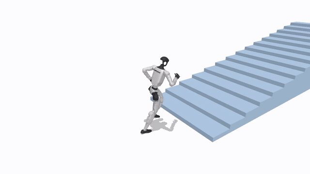
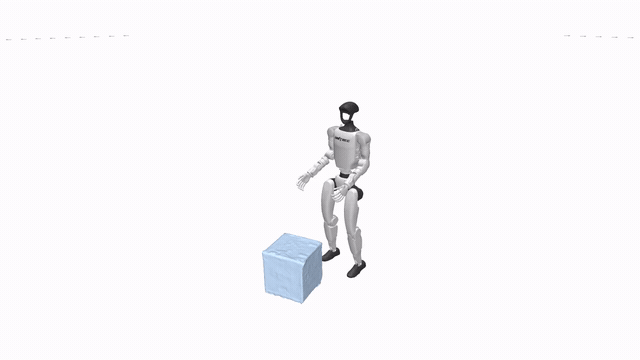
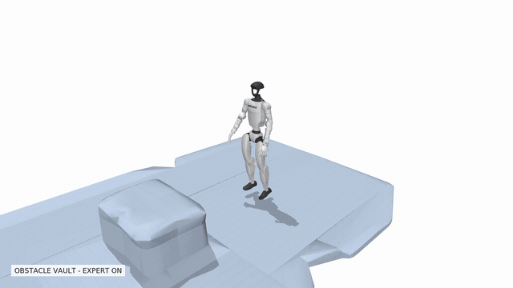
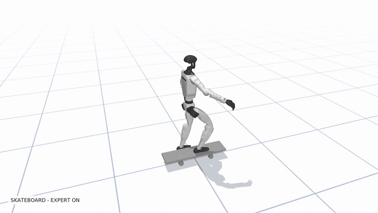
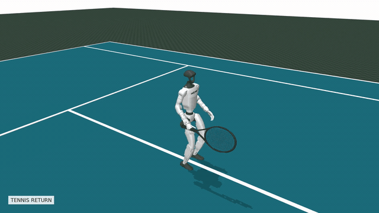
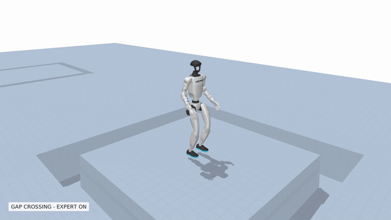

<div align="center">

# PERA

**Plug-in Experts for Robotic Actions in Continual Whole-Body Control**

一个冻结的 HoloMotion 底座，按需启用独立训练的任务专家。

[English](README.md) · [简体中文](README.zh-CN.md) · [项目网站源码](https://github.com/shangchaohu718/PERA/tree/main/website) · [模型](docs/MODELS.md) · [安装](docs/ENVIRONMENT.md)

</div>

PERA 以 HoloMotion 官方 G1 v1.4 `model_14000` 为公共底座，独立训练新增任务 FFN 和 router。公共 Actor 与任务上下文编码器冻结。同一个 Actor 可安装多个任务专家；每个机器人最多开启一个专家，并使用独立时序缓存。

## 技能展示

<table>
<tr>
<td align="center" width="33%"><b>上楼梯</b><br/><a href="docs/media/stairs.mp4"></a></td>
<td align="center" width="33%"><b>搬箱子</b><br/><a href="docs/media/box-carrying.mp4"></a></td>
<td align="center" width="33%"><b>翻越障碍</b><br/><a href="docs/media/vault.mp4"></a></td>
</tr>
<tr>
<td align="center" width="33%"><b>滑板</b><br/><a href="docs/media/skateboard.mp4"></a></td>
<td align="center" width="33%"><b>网球回击</b><br/><a href="docs/media/tennis.mp4"></a></td>
<td align="center" width="33%"><b>跨沟</b><br/><a href="docs/media/gap-crossing.mp4"></a></td>
</tr>
</table>

<sub>来自项目主页的单场景学生录像，保持原速；GIF 循环预览，点击图片查看对应视频。录像展示不等同于新的成功率评测。</sub>

## 安装

使用 Python 3.11，并安装[场景回放说明](docs/SCENE_REPRODUCTION.md)中的固定版本依赖。

```bash
python -m pip install -r requirements/scene-replay.txt
```

## 权重

一个专家权重文件包含 25 个匹配专家；配套复现场景覆盖 15 项任务，分三组串行运行；见[完整场景清单与单权重说明](docs/HOLOMOTION_SKILLS.zh-CN.md)。发布版本不附带 HoloMotion 官方 Actor/Critic 权重。请按[官方下载说明](docs/HOLOMOTION_DOWNLOAD.md)取得指定 v1.4.0 基座，再按 [HoloMotion 权重清单](resources/holomotion_weights_manifest.json)校验。

```bash
python tools/check_holomotion_release.py --base-dir /path/to/holomotion-v1.4
```

## 配套场景

| 物体交互 | 地形 | 全身动作 |
|---|---|---|
| 搬箱子 | 连续上楼梯 | 舞蹈 |
| 网球回击 | 下楼梯 | 武术套路 |
| 滑板 | 不平路面 | 足球控球动作跟踪 |
| 有墙场景翻越 | 跨沟 | 平地前滚翻 |
| 无墙场景翻越 | 斜坡前滚翻 | 跳坐平台 |

共 15 个任务。足球条目是参考动作跟踪，不代表已验收真实球体交互。每组使用同一份 25 专家权重：一个 Actor、每个机器人独立缓存、每次只开启一个新增专家。三组分别运行，按参考末端显式重置回合。

## 运行

受邀用户从 [PERA Releases](https://github.com/shangchaohu718/PERA/releases) 获取配套源码与场景包，按[安装说明](docs/SCENE_REPRODUCTION.md)准备依赖，并从原作者处下载官方基座后运行：

```bash
bash scripts/replay_all_scenes.sh --base-dir /path/to/holomotion-v1.4 \
  --device cuda:0 --video --output runs/scenes15
```

命令会依次输出三组录像和实测报告。也可在本地将官方底座和全部专家一次性合成完整单权重，见[完整清单](docs/HOLOMOTION_SKILLS.zh-CN.md)。

## 项目网站

网站源码和单场景素材位于本仓库的 [website/](https://github.com/shangchaohu718/PERA/tree/main/website)。PERA 保持私有；当前账号套餐不支持该私有仓库的 GitHub Pages，因此新地址尚未上线，旧网页暂时保留。首页与本自述文件不展示合并场景测试拼图。

## 验证范围

此前七场景回放与原学生演示逐帧一致，全部十五项已在独立解压目录和隔离安装环境中完成回放。实测验收结果见[复现记录](provenance/SCENE_REPRODUCTION_CHECK.json)。本次发布用于推理复现；从头训练及论文全部统计结果仍需额外资源和验证。

## 引用

如果你的研究使用了 PERA，请引用 [PERA](CITATION.cff)。

## 许可证

PERA 新增代码采用 [MIT 许可证](LICENSE)。第三方代码、模型权重与数据集保留适用条款，详见[第三方声明](THIRD_PARTY_NOTICES.md)。

<div align="center">


**谢谢你来看看 PERA。留颗 ⭐，或聊聊你的新想法，都是对项目的支持。**

</div>

## 致谢

感谢以下开源项目的作者与维护者，感谢他们提供的代码、预训练策略、动作资源与研究成果：

- [FlexOlmo](https://github.com/allenai/FlexOlmo)
- [HoloMotion](https://github.com/HorizonRobotics/HoloMotion) 和 [BeyondMimic](https://github.com/HybridRobotics/whole_body_tracking)
- [BlinkMimic](https://github.com/fuyichen0725/blinkmimic)、[supermimic_vibed](https://github.com/zita-ch/supermimic_vibed) 和 [InstantTrack](https://github.com/Huy-Quang-Dao/instantTrack)
- [InstinctLab](https://github.com/project-instinct/InstinctLab)、[InstinctMJ](https://github.com/project-instinct/InstinctMJ) 和 [instinct_rl](https://github.com/project-instinct/instinct_rl)
- [MimicX](https://github.com/NEBULIS-Lab/MimicX) 和 [PMT](https://github.com/Mondo-Robotics/PMT)
- [HUSKY](https://github.com/TeleHuman/humanoid_skateboarding)、[ATHLETE](https://github.com/HazinTihoa/athlete-humanoid-tennis) 和 [ULTRA](https://github.com/Sirui-Xu/ULTRA)
- [PBHC](https://github.com/TeleHuman/PBHC) 和 [KungfuBot](https://github.com/thaixuankhanh/kungfubot)
- [unitree_rl_mjlab](https://github.com/unitreerobotics/unitree_rl_mjlab) 和 [unitree_ros](https://github.com/unitreerobotics/unitree_ros)
- [mjlab](https://github.com/mujocolab/mjlab)、[MuJoCo](https://github.com/google-deepmind/mujoco)、[MuJoCo-Warp](https://github.com/google-deepmind/mujoco_warp)、[NVIDIA Warp](https://github.com/NVIDIA/warp) 和 [Isaac Lab](https://github.com/isaac-sim/IsaacLab)
- [PyTorch](https://github.com/pytorch/pytorch) 和 [pytorch_kinematics](https://github.com/UM-ARM-Lab/pytorch_kinematics)
