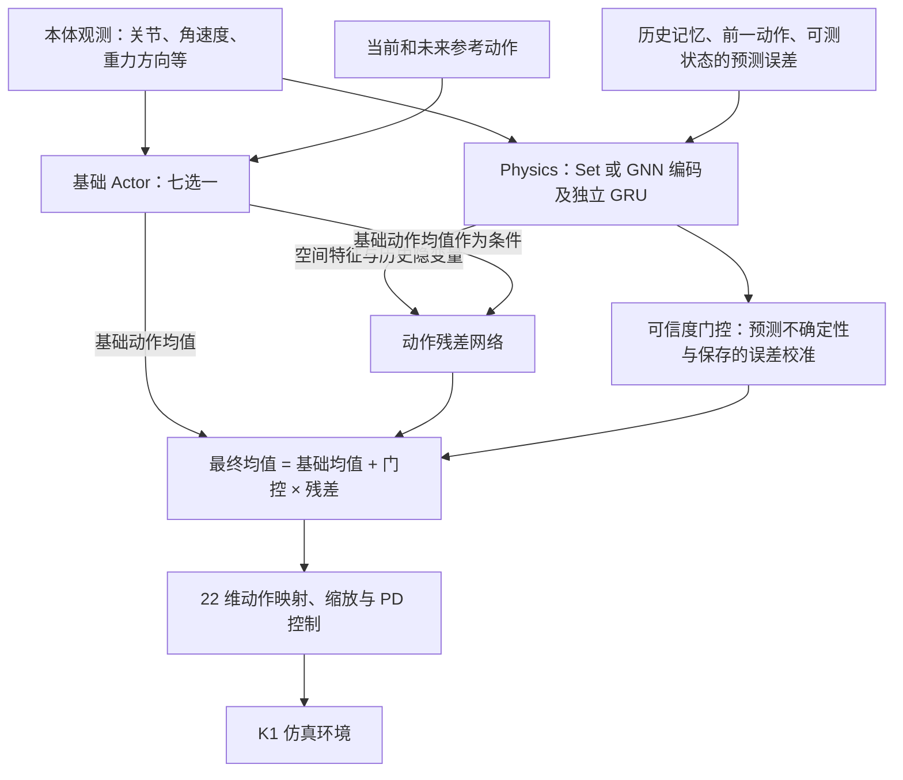
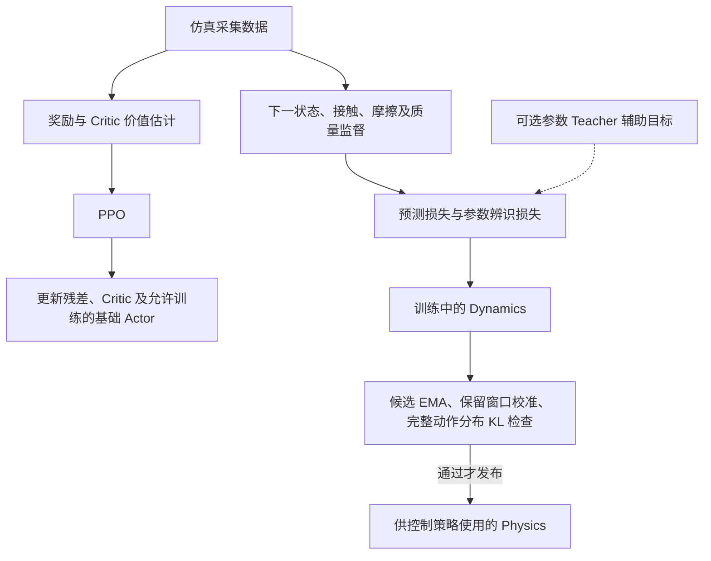

# 当前算法结构与物理反馈研究路线

更新日期：2026-10-12。本文对应统一 K1 入口 `tools/train_k1_mjlab.py`。

当前实现是**可切换基础 Actor，加可选的历史动力学估计和门控动作残差**。
代码链路已通过 CPU 回归；尚未证明 Physics 能提高真实机器人跟踪精度、学习速度或滑板控制能力。
研究目标是让同一个策略覆盖舞蹈、太空步和滑板交互。这个目标值得验证，但需要继续完善接触目标、
移动物体环境、可部署观测和评测协议，不能把网络接口打通等同于已经获得这些能力。

## 当前运行结构

下图表示开启 `--physics` 后的控制路径。关闭它时只保留基础 Actor。



基础 Actor 可选 `holomotion`、`mlp`、`transformer`、`moe`、`gru`、`lstm`、`lru`，每次选一个。
HoloMotion 使用原版网络和预训练权重；自定义网络复用项目已有核心网络，通过新的 K1 输入适配器接入。
统一入口使用 506 维 Actor 观测、843 维 Critic 观测和 22 维动作。未来参考是已提供的任务目标，
不是未来真实观测；部署任务也必须能够提供对应参考窗口。

Physics 是一组学习动力学的神经网络，与模拟物理过程的 MuJoCo/mjlab 环境不同。
它用空间编码和独立 GRU 提取当前特征与历史隐变量，预测下一状态和接触，
并进行参数辨识。当前 K1 参数监督是**摩擦系数、躯干质量缩放**，隐变量并不等于精确物理参数。
下一步预测与之后实际可测状态的差异，反馈到后续 GRU 记忆更新。

残差接收全局空间特征、隐变量、左右脚特征以及基础动作均值。默认残差为
`0.25 * tanh(head_output)`，门控位于 `[0, 1]`；0.25 是原始策略动作坐标中的限幅，
不是力矩百分比。训练围绕修正后的均值采样，确定性评测使用该均值。
当前空间特征也直接进入残差，因此收益是否真的来自历史辨识，需要消融验证。

**这条 K1 主线的 Physics 作用于动作输出端，没有直接接进 HoloMotion 的 MoE 路由。**
原 `api.build_policy()` / `experiment.py` 路线仍使用 `PhysicsObservation + ControlGoal`，
保留物理特征融合及 MoE 物理路由。这是另一种融合方式，不能与统一 K1 残差路线混为同一实验。
原通用入口的 Actor 权重也不能直接替换新 K1 输入适配器的权重。

## 输入边界与信息泄露

部署时能通过传感器、机器人模型或因果估计获得的本体信息，可以同时提供给 Actor 和 Physics。
两者使用同一份观测本身不构成信息泄露；应验证 Physics 是否提供额外价值。

| 信息 | 当前 K1 路径与部署条件 |
|---|---|
| 关节位置、速度、角速度、重力方向、前一动作 | Actor 和 Physics 的正常输入；真机需要对应传感器及估计器 |
| 足端相对身体位置及运动速度 | Physics 使用的运动学量，可由模型、关节状态和角速度重建 |
| 接触估计 | 部署接口允许显式传入；当前 K1 默认未接估计器，相应列置零 |
| 接触槽位掩码 | 表示左右脚槽位存在，不表示该脚当前接触地面 |
| 根部线速度 | 当前 Physics 部署输入不提供真值，占位零且标记不可测 |
| 真实摩擦、质量、精确接触力等仿真信息 | 仅用于训练监督、奖励或特权通道，不能作为部署 Actor 的输入 |

基础 Actor 的 506 维输入没有直接包含接触真值。仿真目前提供理想的姿态和关节状态，
Actor 的航向误差还依赖根部姿态；真机仍需验证姿态估计、航向对齐、噪声、延迟和漂移。
特权通道隔离通过不等于部署观测等价性已经验证。

## 训练结构与更新边界



- Dynamics 使用预测与辨识目标，通过 Adam 优化；GRU 是记忆网络结构，PPO 是控制策略学习算法。
- PPO 不反向更新 Dynamics。HoloMotion 加 Physics 默认冻结预训练基础 Actor；自定义 Actor 从零初始化，默认参与训练。
- Teacher 默认关闭，当前可选 Teacher 是参数自编码辅助监督，不是一个任务控制专家。
- 更新 Dynamics 后，根据当前回合真实历史重建记忆，**不重置环境**。环境仍按任务自身的终止条件结束回合。
- Actor 记忆在 rollout 边界重置以匹配 PPO 重算；Dynamics 历史独立跨 rollout 保留。
- 冻结评测不更新权重或校准，但记忆仍随观测更新。训练恢复从新回合开始，不恢复正在运行的物理世界。
- 门控是经验可信度权重，不是安全概率；KL 检查约束采集状态上的候选更新，不是全局稳定性保证。

## 本轮已经完成的代码改动

| 改动 | 解决的问题 |
|---|---|
| 七种 Actor 的统一 K1 入口 | 同一任务下切换、训练、完整保存、恢复和冻结评测 |
| 残差接收基础动作均值 | 允许相同物理状态在不同动作目标下产生不同修正 |
| 不可测状态显式掩码 | 避免把缺失测量当成零测量，产生虚假预测误差 |
| 预测误差校准与门控 | 避免仅靠网络自报低方差获得高信任 |
| Dynamics 连续更新和历史重建 | 避免更新模型时重置环境或沿用过期记忆 |
| 候选 EMA 与完整动作分布检查 | 限制部署模型更新引起的动作突变 |
| PPO 边界、timeout bootstrap、KL 梯度等修复 | 保持采样、重算与优化的语义一致 |

这些属于正确性修复、接口整合和研究基础设施。详细实现与证据见
[算法修复报告](ALGORITHM_CORRECTIONS_20261012.md)、
[连续性与完整运行时](PHYSICS_RUNTIME_AND_CONTINUITY.md)及
[Actor 切换指南](K1_ACTOR_SWITCHING.md)。

## 物理反馈的研究价值与局限

物理反馈最有希望帮助的是：相同目标在不同摩擦、负载或支撑条件下，需要不同控制的场景。
固定地面的普通舞蹈是否受益尚不明确；现有 Actor 已利用本体反馈及自身历史，额外网络可能重复已有能力。
最需要警惕的是预测误差下降，却没有带来跟踪或成功率改善。

| 目标任务 | 当前还缺的任务设计 |
|---|---|
| 舞蹈 | 多动作训练、跟踪与完成率基线、避免新增适应损害已有精度 |
| 太空步 | 区分支撑、离地、主动滑动阶段，跟踪期望相对滑动而非一律防滑 |
| 滑板 | 移动板面和轮系动力学、脚与板的接触关系、板状态估计、蹬地与转向目标 |

当前开启 Physics 的 K1 CLI 默认对接触中的左右脚滑动施加惩罚（权重各 0.02），
未区分滑动意图。这会与太空步的主动滑动产生目标冲突，应先修正接触目标和奖励。
滑板上的脚随板在世界中移动不等于脚底打滑，应比较脚与板的相对运动。

当前 K1 部署路径传入空物体集合，两个脚部槽位对应静态地面。基础库的物体接口和 GNN 开关
不代表滑板已经接通。只靠关节和 IMU 不能保证推断所有板状态，需要可部署的外部感知或经过验证的估计器。
没有相关交互数据、正确环境和可获得的信息，增加网络规模也不能补足这些条件。

建议先保留当前残差作为对照。任务、观测和奖励修正后，再比较隐变量直接融合 Actor 与残差接法。
一个模型可以通过参考目标、接触目标和可选物体槽位覆盖多任务；应以同一 checkpoint 的混合任务结果验证，
不能把各任务单独训练的策略称作同一个通用模型。

## 创新判断与榜单目标

“基础策略加适应模块”已有 [RMA](https://arxiv.org/abs/2107.04034)，
动作输出叠加学习修正已有 [Residual RL](https://arxiv.org/abs/1812.03201)。
人形残差适配还包括 [ASAP](https://arxiv.org/abs/2502.01143) 和
[MOSAIC](https://arxiv.org/abs/2602.08594)。单纯组合 GRU、GNN、MoE 或 Physics 不能据此认定创新。

[HEFT](https://arxiv.org/html/2607.02332v1) 使用 MLP 策略及 RMA 式适应结构，
通过特权运动引导和负载课程研究带负载的运动跟踪。
[HUSKY](https://arxiv.org/abs/2602.03205) 已验证真实人形滑板控制，包含人板系统建模、
运动先验及蹬地与转向设计。这些工作支持相关任务的可行性，但不证明当前 K1 模块的效果。

值得检验的研究假设是：**任务相关的接触反馈，能让一个策略统一处理支撑、主动滑动和移动支撑，
在有限训练预算下保持跟踪精度。** 这是待验证假设，首次性仍需更完整文献对照。

截至本次查阅，[sim2real Motion Tracking Leaderboard](https://egalahad.github.io/sim2real/leaderboard/)
可按不同误差指标排序，GPU Hours 单独列示；不能视作已确认的准确度与时间合成总分。
页面排名会变化，具体结果必须附版本、数据集选择与排序指标。

其[评测协议](https://egalahad.github.io/sim2real/tutorials/cross-codebase-evaluation/)
采用固定 G1 MotionDecode 子集、统一 MuJoCo 评测器和 CPU ONNX 推理。
当前 K1 22 自由度结果不能直接进入这一比较；需要 G1 任务、正确观测与动作合同，以及完整策略和记忆状态的部署适配。
该榜的 Manipulation 身体跟踪不等于物体任务成功，滑板能力还需独立交互评测。

## 建议的最小验证与推进顺序

先固定一个 Actor、同一任务和奖励，在几种摩擦条件下比较：

1. 原策略。
2. 增加相近容量的普通历史网络，不加入物理预测辅助监督。
3. 增加 Physics，使用动力学预测和辨识监督。

各组使用相同可部署输入，并分别进行环境步预算匹配和实际训练成本比较。
保留未训练过的物理条件作为测试，另用验证集选择配置；不要用测试集反复调参。
小规模筛选后，对有希望的配置至少训练三个随机种子，报告不确定性和失败案例。
打乱隐变量、清除历史、关闭门控可检查策略依赖，但不能替代重新训练的容量匹配对照。

如果 Physics 优于普通历史网络，适应更快且资源成本合理，才有继续扩大的实证依据。
如果只改善预测损失，就调整监督目标、简化或移除该分支。

推进顺序：

1. 以目标榜单为准适配 G1、建立可复现跟踪基线；K1 保留独立实验和结果。
2. 先验证舞蹈与太空步，接通接触目标并修正滑动奖励，确认 Physics 的额外收益。
3. 加入移动平台、滑板动力学和部署状态估计，先验证基本站板、行驶和转向。
4. 混合任务训练同一个模型，检查交互能力、普通跟踪精度和计算开销之间的取舍。

榜单评测应同时报告身体位置/姿态误差、根部误差和完成率，避免提前失败造成误差看似更低。
交互评测另外报告期望滑动、支撑切换、滑板任务成功率及未见物理条件下的表现。
训练效率比较应注明 GPU 型号和数量，报告误差随 GPU 小时的曲线；教师、Dynamics、校准与历史重放
都计入成本，预训练成本和新增训练成本分别披露。现在不承诺提升幅度或榜单排名。

## 验证范围与阅读入口

发布回归记录为 **752 passed、0 failed、18 CUDA skipped，445 subtests passed**。
包含七种 Actor 乘 Physics 开关的 CPU 生命周期测试、PPO 更新、Dynamics 连续更新、保存加载、
恢复和冻结一致性。发布前还修复了 Windows 默认 GBK 读取 UTF-8 报告/测试资料的问题，
将 Actor 专用 YAML 放到 `configs/actors/`，并验证六种自定义主干均能加载该配置运行。
CPU 环境没有可用的 CUDA/mjlab/MuJoCo/Warp，未验证正式机器人运动收益。
发布检查摘要保存在 [本地验证摘要](../reports/local_validation_20261012.json)。

复现代码回归：

```bash
python tools/evaluate.py --output runs/local_validation/recheck
```

训练命令、配置、兼容边界见 [Actor 切换指南](K1_ACTOR_SWITCHING.md)。
历史审查文档保留各阶段结果，不用旧测试数量代替最新回归，也不用测试通过代替运动效果。
