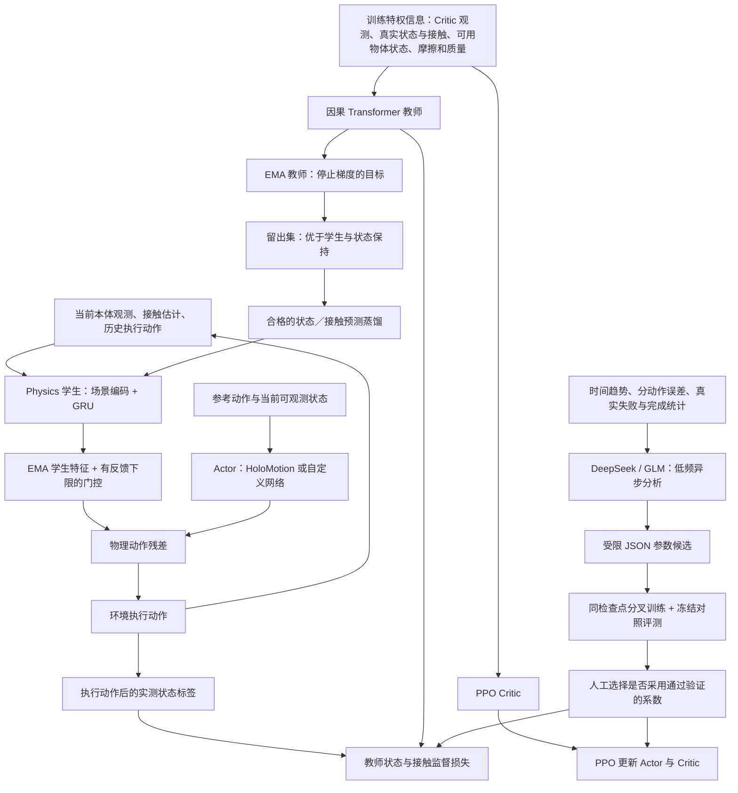

# Transformer 物理教师与 LLM 训练顾问（2026-10-13）

当前实现：**物理残差保留有限反馈能力；特权 Transformer 教师通过预测质量检查后在线蒸馏给 Dynamics 学生；DeepSeek／GLM 根据有时间顺序、分动作的日志提出受限调参候选。** Actor 仍可选择 HoloMotion 或六种自定义主干，部署时运行学生与 Actor。PPO Critic 继续拟合数值回报。

代码链路可以本地验证；控制精度、收敛速度和 sim2real 收益必须通过真实仿真实验判断。教师拥有更多信息不等于学生一定能恢复这些信息，LLM 的解释也不构成实验结论。

## 结构与信息边界



实线表示数据或训练关系；图中的特权输入与教师目标只存在于训练阶段。蒸馏箭头表示更新学生参数，不表示运行 Actor 时给它额外输入。

### 教师具体学什么

- 输入是**执行当前动作之前**的 843 维 Critic 观测、当前身体／根部速度／真实接触、可用物体槽、有效性掩码，以及当前随机化摩擦与质量参数。Critic 中的未来参考动作是已知目标，不是未来实测状态。
- 两层、宽度 64、4 个注意力头的因果 Transformer；默认每层注意力窗口 32 步，禁止跨回合关注。它不接收未来实测观测、奖励或下一状态标签作为输入。
- 教师内部仍有 latent，下一状态解码器另接收实际执行动作。新 `objective_version: 2` 只监督归一化状态和接触，**去掉把输入摩擦／质量复制到输出的重建任务**；旧 ID 输出头仅为检查点兼容保留。教师的重力方向与学生一样归一化为单位向量，退化时采用当前方向或固定单位向量，避免生成学生无法表示的蒸馏目标；v1 保留原输出语义。
- 独立 Adam 优化教师：状态按根线速度、角速度、重力方向、关节位置、关节速度五组等权平均，再加接触 BCE，避免关节维度数量掩盖根状态误差。
- **不再逐维对齐教师与学生 latent。** 蒸馏目标是停止梯度的下一状态预测与接触概率；学生自身的实测转移预测和 ID 监督继续训练。默认蒸馏系数 0.05，前 20 次教师更新升温，但升温不能绕过质量检查。
- 每个窗口分为 burn-in、训练前段、教师验证段、最终门控校准段。后两段都不进入教师／学生梯度损失。默认教师验证占 burn-in 后窗口的 25%，最终校准占 25%。质量门槛按五组状态和一组接触分别判断：至少 16 个有效转移；EMA 教师误差须比当前学生和“保持当前状态／接触”两者都低至少 5%。不合格的组不蒸馏。样本不足时蒸馏为零，直接监督仍正常训练。动作打乱误差仅作诊断，`minimum_action_gain` 定义诊断阈值；惯性或控制延迟导致当步动作影响弱时，不再否决准确教师。
- 默认每次更新选择最多 64 个环境并轮换；教师更新一次，学生多个 epoch 复用冻结目标和首次学生更新前的质量判定。动作打乱对照复用同一个教师 latent，仅更换解码器的执行动作。

接触保持对照现在使用**执行动作前的真实接触**，独立保存在教师专用 rollout 字段中；不再读取学生接口默认全零的接触占位。接触准入要求当前和下一帧的真值都有效。否则，“持续着地”会被错误地拿来与“一直离地”比较，使接近随机猜测的教师也能通过。真值不进入部署学生输入。

这里的“留出”是同一采样窗口内的时间分割，**不等于独立场景泛化或统计显著性证明**。16 个相邻转移也不是 16 个独立回合。某组长期不通过时应检查实际误差和可辨识性，不能直接降低门槛宣称成功。

### 物理门控和预测跨度

新 K1 训练默认使用 `--physics-gate bounded --physics-feedback-floor 0.1`。旧 `calibrated` 会把先验相对预测信息与最差参数的 skill 再相乘，容易接近平方衰减，零门控时残差 PPO 梯度严格为零。

新公式为 `g = f + (1-f) × 平均参数信息 × 校准样本就绪 × 回合证据年龄`，其中 `f=0.1`。参数信息仍以保存的留出 MSE 和校准方差为下限计算，但不重复乘 skill，也不让一个无法辨识的参数否决全部接触／历史特征。采样、PPO 重算与冻结推理使用同一公式；没有训练专用的假梯度。

残差继续零初始化、受 `0.25 × tanh` 限幅。没有辨识证据时，门控下限只允许每关节最多 **0.025 动作单位**的均值修正；随着证据增强，这个预算可增大至原有 0.25。下限是明确的反馈预算，**不是“10% 安全概率”或已经辨识成功的声明**。Dynamics／校准更新仍要通过完整策略的平均／最大 KL 发布检查，更新后重建历史记忆，不重置环境。KL 只约束更新幅度，不证明控制一定改善。

新构造的 Dynamics 默认启用 1 步和 4 步预测。原有一步监督之外，新增 `0.1 × 四步归一化分组 MSE`；四步头使用按原顺序记录的实际执行动作。跨 reset、超出训练前段的片段不进入损失，末次转移的 reset 前终态仍可作为标签。该头只辅助训练，不增加部署动作推理的四步展开。它也不等于长时滚动世界模型。

旧检查点仍用保存的门控与预测跨度；没有教师目标版本字段的包按 v1 恢复旧 latent／参数重建目标，不静默改变算法。旧 `calibrated`、schema 4 推理和新 `bounded` 都有保存／加载与消融回归。

“所有特权信息”在当前代码中指**现有任务接口提供的这些字段**。没有读取任意 MuJoCo 内部状态。当前 K1 场景没有滑板；4 个可用物体槽是接口容量，空槽被掩码屏蔽。这次没有增加滑板实体、轮地摩擦、板体转动或专用交互目标。

学生仍是原来的 Dynamics GRU；Actor 主干不因此换成教师 Transformer。教师、教师 EMA、其优化器与更新计数保存进完整 `.pt`，训练恢复全部还原。冻结加载不构造教师网络；训练专用张量保留在 CPU，部署计算图不读特权输入、不调用 LLM。完整训练包并不等于最小部署导出包。

### 仍然需要挑错的地方

1. **可辨识性限制。** 同样的静止观测可能来自不同摩擦系数；交互尚未发生时，学生无法唯一推断真值。物理预测蒸馏消除了 latent 坐标对齐问题，但不会凭空创造可观测信息；仍须跨物理条件评测。
2. **反馈预算不是收益保证。** 新门控消除了“参数辨识不成功就完全不训练残差”的死锁，但无法自动证明接触特征有用。仍须比较无 Physics、旧校准门控、新有界门控的同预算完整策略结果；部分参数可信时采用均值也意味着比最差维度门控更宽松。
3. **教师的“物理规律”范围有限。** 这是监督学习得到的条件转移模型，不是守恒定律保证或万能世界模型；接触突变、长时滚动误差、未见对象仍可能失败。
4. **太空步与滑板不能一律惩罚世界坐标系滑动。** 当前训练严格沿用 HoloMotion v1.4 奖励，不附加脚滑或脚部冲击惩罚；若未来需要这类目标，应明确参考接触阶段和相对支撑面的目标速度，而不能让 LLM 用调系数替代场景建模与正确奖励设计。

已有 `training_20261013_k1_walk_ab_5k_seed42` 是 **Teacher 关闭**的实验：基线 5000 次迭代、Physics 仅 1560 次。两者共同的 1460–1559 区间中，Physics 门控只在 6 次迭代非零；前 1560 次日志中的采样＋更新时间约为基线的 2.79 倍。它没有证明 Physics 有收益，也不能直接评价这次新教师。不要把终止次数解释成跌倒次数。

## LLM 参与哪里

当前是低频的**实验建议器**。它接收有限数值统计，输出 `reason` 和 `changes`；不直接生成网络参数、动作、PPO advantage 或 Critic value target。每轮最多调整 3 个键，单次相对变化不超过 25%，同时满足绝对范围；不能启用原本为零的损失。

| 可调整项 | 范围／含义 |
|---|---|
| `ppo.entropy_coef` | 0–0.05，探索熵系数 |
| `optimizer.critic_learning_rate` | 1e-7–1e-2，Critic 实际优化器学习率 |
| `loss.system_identification_weight` | 0.001–2，学生 ID 损失 |
| `optimizer.teacher_learning_rate` | 1e-7–1e-2，存在 Transformer 教师时的实际学习率 |
| `loss.teacher_distillation_weight` | 0–0.5，学生蒸馏损失 |
| 左／右脚 slip、impact reward weight | 各自 0–0.2 |
| `curriculum.clip_weights` | 动作采样权重，均值 1，单项 0.25–4；单次变化 ≤25% |

原来的 `ppo.value_loss_coef` 和 `loss.teacher_reconstruction_weight` 不再向 LLM 开放：独立 Adam 会大幅抵消整体损失倍数变化。新学习率修改真实优化器的 param groups，并同步配置；保存／恢复保留修改值。旧候选不会被偷偷映射成新旋钮。

摘要保留首末值、前后段均值、按真实迭代间隔计算的斜率、最近 8 个有序点。分动作摘要只发送稳定整数 `clip_id`、采样步数、固定跟踪误差、真实失败和参考完成数；局部动作名不发给 API。逐动作误差同时保留按步数加权均值。首次加入了失败／完成独立诊断项，它们在奖励总和确定后记录，不改变奖励。

调整课程时，每个改动的动作 ID 都必须有至少 32 个采样步的固定误差记录及完整失败／完成计数；没有这些证据便拒绝建议。旧日志只有文件名时不会猜测 ID。采样步数只是曝光量，不能当作独立回合成功率。候选保存数值证据及其 SHA，在应用与对照验证时再次检查。

课程权重仅作用于之后自然重置的回合，不重置正在运行的环境，也不能把某个动作概率降为零。调整候选只允许在新实验开始、采样前应用；候选保存原参数指纹，参数已变化则拒绝应用。新日志每轮保存实际优化器快照，离线建议优先使用最近快照，避免学习率调度后仍采用开跑时的旧值。

带课程权重的检查点同时保存有序动作名称与内容 SHA；恢复时必须匹配名称、内容和顺序，避免太空步的权重被分给舞蹈。动作清单缺失的旧加权包不允许直接恢复训练，需用核对过的原动作库重新导出；冻结推理仍可读取。仅交换文件顺序也会明确报错，不猜测如何重新分配权重。

默认每 500 次迭代分析最近 100 条记录，最多 8 次请求、每次最多 1 次重试。请求在单独线程中执行，不等待于机器人控制步内；结束训练时才等待未完成请求。超时、非法 JSON、越界参数、空回答或截断回答都不会修改训练。记录 token 用量、耗时和重试次数；网络错误时无法确认的计费用量保持未知，次数预算不是精确金额上限。

日志输入采用数值字段白名单，不发送检查点、原始轨迹、机器路径、动作文件名或整个 runner metadata。`task_description` 是会发送的自定义文本，请只填写任务描述。API 密钥只从当前训练进程的环境变量读取，不写进 YAML 或检查点。

用户提到的项目应是清华 AIR 等团队的 [Zetta](https://air-embodied-brain.github.io/zetta/)／[论文](https://arxiv.org/html/2608.16590v1)。它通过多时间尺度的批评器和恢复技能改进冻结的基础 VLA；其中 runtime critic 与 PPO 的价值函数不同。本项目这次实现的是系数建议与实验验证接口，没有复现 Zetta 的运行时纠错系统。

## DeepSeek／GLM 接入

| 配置 | 环境变量 | 标准接口 |
|---|---|---|
| `configs/advisors/deepseek.yaml` | `DEEPSEEK_API_KEY` | `https://api.deepseek.com/chat/completions` |
| `configs/advisors/glm.yaml` | `GLM_API_KEY` | `https://open.bigmodel.cn/api/paas/v4/chat/completions` |

采用标准库 HTTP，不要求安装 OpenAI SDK。模型名称可在配置中改为账号实际可用的模型。GLM 当前适配国内 BigModel 标准 API；Z.ai 国际接口与 Coding Plan 专用入口不在本次范围。参考 [DeepSeek JSON 模式](https://api-docs.deepseek.com/guides/json_mode/) 与 [BigModel 兼容接口](https://docs.bigmodel.cn/cn/guide/develop/openai/introduction)。

密钥在启动训练的终端环境中设置即可，无需发送到聊天或提交仓库。默认请求 JSON object；若选用模型不支持该服务端参数，将配置中的 `json_mode` 改为 `false`，本地 JSON 解析和系数校验仍然生效。

## 运行与对照

以下命令在仓库根目录运行，需要真实 K1 资产、具名动作 NPZ、观测／关节合同和 CUDA／mjlab。可以用 `--task-contract /path/to/contract.json` 替代 ONNX 元数据。

```bash
# 从零训练 HoloMotion + Physics + Transformer Teacher；LLM 可选。
python tools/train_k1_mjlab.py \
  --actor holomotion --holomotion-config configs/actors/holomotion_k1_16e.yaml \
  --onnx /path/to/k1.onnx --asset-root /path/to/assets --motion /path/to/walk.npz \
  --output-dir runs/teacher --num-envs 512 --iterations 2000 --seed 42 \
  --physics-teacher --physics-teacher-config configs/teachers/k1_transformer.yaml \
  --advisor-config configs/advisors/deepseek.yaml
```

删去 `--advisor-config` 就完全不调用 API。用 `configs/advisors/glm.yaml` 切换提供商。自定义 Actor 的 `--actor`／`--actor-config` 用法不变。单独 `--physics` 仍然不启用教师。

CLI 的 `--physics-teacher` 现在选择 Transformer；复现旧 MLP 教师用 `--physics-teacher --physics-teacher-architecture mlp`。旧检查点恢复时保留原结构，不静默升级。Python `create_k1_trainer(teacher=True)` 为兼容旧调用仍选旧 MLP；另传 `privileged_teacher_config={}` 才启用新教师。

随机初始化 Actor 在 CLI、Python 工厂和直接 Physics PPO 构造中默认参与训练。严格加载原版 safetensors 后才标记 `pretrained=True` 并默认冻结；显式 `PhysicsUpdateConfig(freeze_base_actor=...)` 优先，完整检查点恢复沿用保存的冻结选择。

随机初始化 HoloMotion 的 Actor／Critic 归一化统计在**整轮 PPO 更新结束后**按观测时间顺序推进 EMA。采样、bootstrap 和全部 PPO 重算期间统计固定，每个环境步只更新一次，不随优化 epoch 重复计数；冻结 Actor 的统计也不更新。模式和统计都随检查点保存。预训练导入和缺少模式字段的旧包默认保留原有统计行为；旧从零训练包若要启用修复，可加 `--observation-normalization update`，或在采样前调用 `configure_observation_normalization(enabled=True)`。`frozen` 可显式关闭更新，默认 `auto` 沿用已保存模式。归一化模式进入训练对照协议。

采样与 PPO 重算统一使用网络 `eval()` 模式，关闭 Dropout；这不会关闭梯度，Actor／Critic 参数仍正常优化。默认 Dropout=0 和显式非零配置都验证了更新前动作概率重放一致性。此前非零 Dropout 会使没有任何权重更新的同一动作产生不同 log-prob。

先看将发送的提示词，无需 API 密钥或仿真：

```bash
python tools/advise_training.py --provider deepseek --model deepseek-flash \
  --metrics runs/teacher/metrics.jsonl --runner-metadata runs/teacher/mjlab_runner.json \
  --output runs/prompt_preview.json --dry-run
```

也支持 `.jsonl.gz`。新日志含逐轮 `training_tuning`，此时 `--runner-metadata` 可以省略；老日志仅可用该参数提供实际快照作为回退。已废弃旋钮的旧快照会被拒绝，不能猜一个快照后直接应用候选。去掉 `--dry-run` 才会调用 API，输出状态为 `unvalidated_candidate`。

在 **同一个完整检查点**上分叉，保证动作文件、顺序、环境数、步长、训练种子与训练步数一致。例：从 `model_1999.pt` 再训练 100 次，最终是 `model_2099.pt`。

```bash
python tools/train_k1_mjlab.py --resume runs/teacher/model_1999.pt \
  --asset-root /path/to/assets --motion /path/to/walk.npz \
  --output-dir runs/trial_base --num-envs 512 --iterations 100 --seed 42

python tools/train_k1_mjlab.py --resume runs/teacher/model_1999.pt \
  --asset-root /path/to/assets --motion /path/to/walk.npz \
  --output-dir runs/trial_candidate --num-envs 512 --iterations 100 --seed 42 \
  --trial-adjustment runs/teacher/advisor/proposal_1999.json
```

候选文件名取实际生成结果；如果建议没有改动，不必消耗训练预算试验。两个实验在不同目录保存，不覆盖原检查点。这个过程恢复参数与优化器，重新初始化环境；它不是精确恢复仿真现场。LLM 本身不自动启动这些昂贵实验。

对两个最终检查点分别执行固定协议的冻结评测，至少采用 3 个评测种子；同一个对照必须用相同评测动作和物理设置：

```bash
# 分别替换 trial_base / trial_candidate，seed 用 0、1、2 各运行一次。
python tools/evaluate_k1_mjlab.py --checkpoint runs/trial_base/model_2099.pt \
  --asset-root /path/to/assets --motion /path/to/heldout_walk.npz \
  --num-envs 64 --steps 3000 --seed 0 --output runs/base_eval_0.json

python tools/validate_advisor_trial.py --proposal runs/teacher/advisor/proposal_1999.json \
  --baseline runs/base_eval_0.json runs/base_eval_1.json runs/base_eval_2.json \
  --candidate runs/candidate_eval_0.json runs/candidate_eval_1.json runs/candidate_eval_2.json \
  --output runs/admission.json --max-cost-ratio 1.25 --primary-metric root_position_error_m
```

验证器校验完整策略冻结、训练起点与种子、训练／评测协议、动作文件 SHA、训练转移数、候选指纹和实测计算耗时。比较根位置／姿态／线速度、关键身体线速度误差、物理失败和参考完成数；**不比较改变过的 shaped reward**。每个协议的跟踪误差最多上涨 2%，失败／完成数不能变差，采样＋更新时间默认不得超过基线 1.25 倍。此外，每项跟踪误差在所有配对评测中的等权均值都不得退步；事先选定的主指标均值须下降超过 2%，或完成／失败计数改善。不再允许一次局部改善掩盖多数指标退步。默认主指标为根位置误差，`--primary-metric` 应在实验前选定，不能看完结果再挑有利指标。输出 schema 2 保存各项均值、相对变化与主指标判定。

新报告还必须携带 `training_trial` 及其指纹：从源检查点继承的建议、源调参快照、本次新应用的建议与实际开跑调参快照分别记录。基线必须保持源调参快照且不应用新建议；候选只能应用指定建议。源检查点已经包含的旧建议可以由两边共同继承。浮点比较只容忍 float32 表示误差；缺少这组证据的旧报告不能作为新验收依据。一个分叉不能连续叠加多个建议后仍冒充单项对照。

这里的计算时间是采样＋PPO＋Dynamics（含教师）更新时间之和，不含初始化、写检查点或 API 时间；后者单独记录。正式比赛还应计算端到端墙钟时间和总试验搜索预算。3 个评测种子不是 3 个独立训练种子，也不代表统计显著性。

`accepted=true` 只生成评估结论，不修改部署或原训练进程。采用通过验证的实验结果需要显式选择其检查点或系数；自动调度多个对照实验、自动在线晋升的实验管理器不在本次实现中。

## 推荐研究顺序与验收范围

先比较：①原 Actor；②Actor + 学生 Physics；③再加 Transformer 教师；④再加 LLM 建议的、经验证的系数。统一场景、动作集、训练预算并至少做 3 个训练种子；保留未参与建议和选择的最终测试集。报告固定误差、成功率、失效场景、吞吐、教师开销、API／参数搜索成本，才能讨论是否值得作为创新点。

本机 CPU 回归覆盖因果性与回合屏蔽、实际 PPO 残差更新、训练／教师验证／校准隔离、物理预测蒸馏停止梯度、合格／不合格教师、四步头梯度与 reset 边界、在线更新不重置环境、完整恢复与冻结推理，以及 API 模拟响应、趋势反例、分动作证据、优化器实际更新幅度、课程与对照验证。

另有可复现的三种子合成学习实验：

```bash
python tools/validate_mechanism_learning.py --output runs/mechanism_learning.json
```

它用生产残差模块拟合有界修正，用实际 Transformer 教师拟合已知转移：`d = 0.2 × gain × action[0]`，非重力状态为 d，重力为 `unit([d,0,-1])`。gain 仅作为教师输入；这个设定故意保留学生无法恢复隐藏参数的限制。结果记录于 [合成学习报告](../reports/logic_fixes_learning_20261013.json)。旧零门控不学习，新门控留出误差下降约 95.7%–97.3%，最大修正小于 0.025；教师结果逐种子列出，缺少接触标签的组仍关闭。**这些是人工构造数据上的机制证据，不能表述成机器人精度提升 96%。**

当前回归汇总见 [第二轮逻辑修正报告](../reports/second_logic_fixes_20261013.json)；此前 `logic_fixes_20261013.json`、`mechanism_fixes_20261013.json`、`mechanism_learning_20261013.json` 和 `teacher_llm_validation_20261013.json` 保留为历史记录。两个 API 的真实请求、真实 CUDA/mjlab 训练、机器人技能、榜单收益尚未验证。
